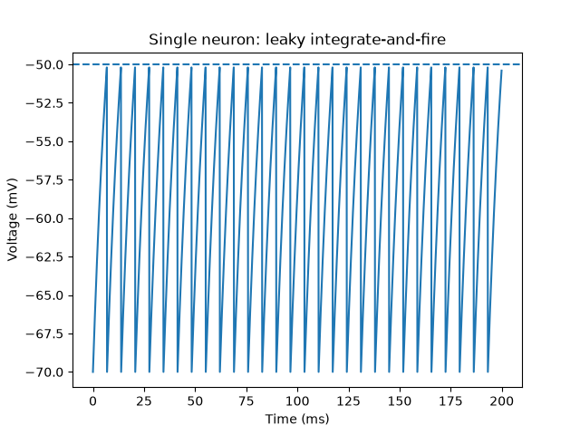

# Single Neuron Model (Leaky Integrate-and-Fire)

Project 1 of a computational neuroscience series.

This project simulates one neuron. Its voltage rises when it receives input, leaks back toward rest, and fires a spike when it reaches a threshold.
## Results

- Input 20: the voltage rises but levels off below -50 mV, so there are 0 spikes.
- Input 40: the voltage crosses -50 mV and resets, giving 28 spikes in 200 ms.

A stronger input makes the neuron fire more often.
## Graph

